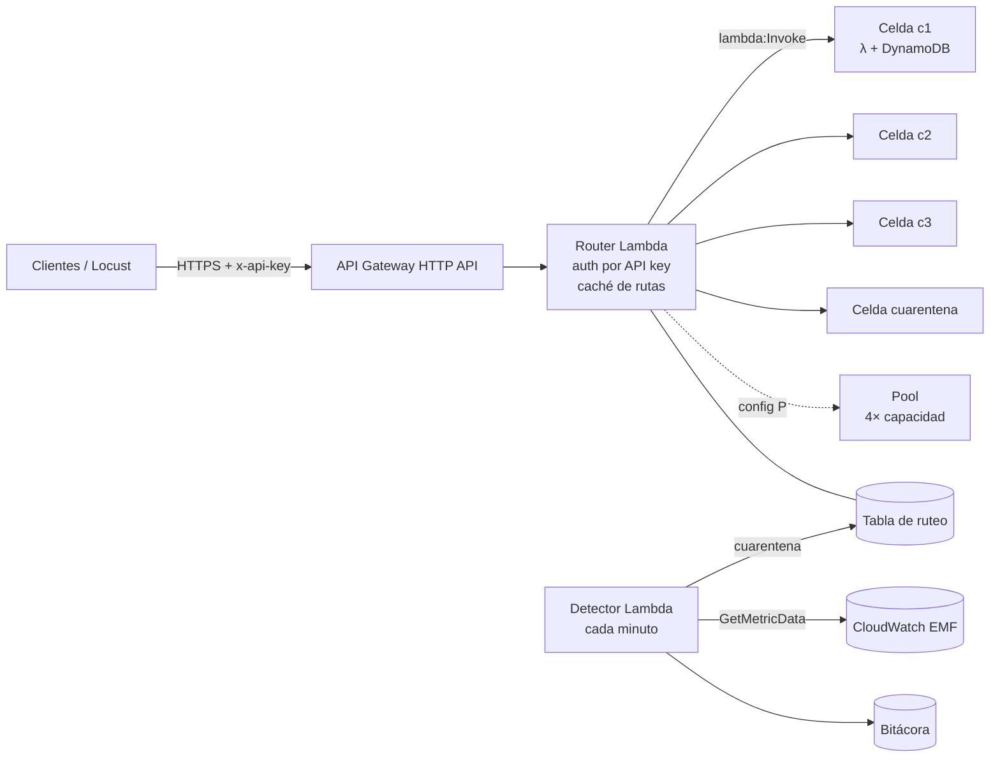

# CellSaaS: aislamiento de tenants ruidosos con arquitectura por celdas y detección de anomalías

Prototipo del proyecto final del curso AYGO (Arquitectura de Software, Arquitectura Empresarial y Gobierno de TI). Un SaaS de pedidos multi-tenant mínimo desplegado en AWS con el mismo código en dos topologías, **pool** compartido y **celdas**, más un plano de control que detecta al tenant que degrada a sus vecinos y lo aísla en una celda de cuarentena.

> Estado: plano de datos y plano de control listos. Arnés de carga y análisis en curso.

## Arquitectura



- **Celda**: una función Lambda y una tabla DynamoDB con capacidad acotada (`templates/cell.yaml`). El pool es la misma celda con 4× capacidad.
- **Router**: autentica al tenant por API key (hash HMAC), resuelve su celda con caché y la invoca (`templates/platform.yaml`). Si el tenant está en cuarentena, sus lecturas de pedidos viejos se resuelven en su celda de origen.
- Decisiones: [ADRs](https://github.com/bricenojuliana/AYGO-Cell-Based-Isolation-Architecture).

## Estructura

| Ruta | Contenido |
|---|---|
| `src/cellsaas/domain.py` | Reglas de pedidos (sin AWS) |
| `src/cellsaas/cell/` | `handler` → `service` → `ports` → `repository` (DynamoDB) y `faults` (SSM) |
| `src/cellsaas/router/` | `handler`, `directory` (auth y caché de rutas), `invoker` |
| `src/cellsaas/routing.py` | Tabla de ruteo: registro, asignación, cuarentena y liberación |
| `src/cellsaas/control/` | Plano de control: `placement`, `metrics` (CloudWatch), `detector` (z-score), `policy`, `loop`, `store` (auditoría) |
| `templates/` | SAM: `platform.yaml`, `cell.yaml` y `control.yaml` |
| `scripts/` | Despliegue, tenants, fallas, smoke test |
| `tests/` | Unitarias, adaptadores (moto) e infraestructura (reglas de templates) |

## Pruebas locales (sin AWS)

```bash
python3 -m venv .venv && .venv/bin/pip install -r requirements-dev.txt
.venv/bin/python -m pytest --cov=src/cellsaas
.venv/bin/ruff check src tests scripts && .venv/bin/cfn-lint templates/*.yaml
```

## Despliegue

Ver [docs/DEPLOY.md](docs/DEPLOY.md) (AWS Academy Learner Lab, CloudShell, `LabRole`).
